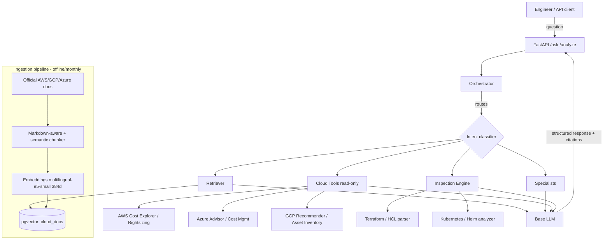

# Technical Architecture — Cloud Intelligence Platform

## 1. Overview

CIP is a **RAG-first system with specialist orchestration** and **read-only tools**.
The LLM only reasons; knowledge comes from the vector database and volatile facts (price,
inventory) come from live calls to the clouds' APIs.



## 2. Components

### 2.1 Orchestrator (`cip.agents.orchestrator`)
- Classifies intent (pure knowledge, environment analysis, cost, IaC inspection).
- Decides which specialists and tools to trigger.
- Consolidates partial responses into a structured report with prioritization.

### 2.2 Retriever + RAG engine (`cip.rag`)
- Local embeddings `intfloat/multilingual-e5-small` (384d) — zero cost per token.
- Vector search in `pgvector` with filter by `cloud`, `service`, `category`, `framework`.
- Applies `RETRIEVAL_MIN_SCORE` to discard irrelevant context (anti-hallucination).

### 2.3 Specialists (`cip.agents.specialists`)
Each specialist is a prompt + set of focused tools/retrieval filters:
`aws`, `gcp`, `azure`, `kubernetes`, `terraform`, `finops`, `security`, `sre`.
Introduced incrementally (see roadmap).

### 2.4 Read-only Cloud Tools (`cip.tools`)
- **AWS**: Cost Explorer, Rightsizing, orphaned volumes/snapshots.
- **Azure**: Advisor (Cost/Security/HA), Cost Management.
- **GCP**: Recommender (cost, idle resources), Asset Inventory.
- Global lock `CIP_READONLY=true`: any attempt at a mutating action is blocked.

### 2.5 Inspection Engine (`cip.inspection`)
- **Terraform/HCL**: parser + rules (public resources, missing encryption, missing tags, etc.).
- **Kubernetes/Helm**: manifests (privileged, missing limits, hostNetwork, broad RBAC).

### 2.6 Persistence
- `cloud_docs`: knowledge base (RAG).
- `environments` / `analyses` / `findings`: history and prioritization.

## 3. Flow of an `/analyze` request

1. Client sends question + (optional) IaC/manifest artifacts + cloud scope.
2. Orchestrator classifies and assembles the execution plan.
3. Retriever brings official context; tools bring live data; inspection analyzes files.
4. Relevant specialists generate findings with severity + financial impact.
5. Orchestrator consolidates into the standard format (executive summary → risks → plan → roadmap).
6. Result is persisted (`analyses` + `findings`) and returned with citations.

## 4. Standard response format

```
1. Executive summary
2. Current architecture (inferred)
3. Findings by domain (security, cost, reliability, performance, operations)
4. Prioritization (Critical/High/Medium/Low + $ impact + effort + ROI)
5. Improvements plan + roadmap
6. Official references (with URL/version)
```

## 5. Anti-hallucination (how we guarantee "not generic")

| Mechanism | Effect |
|---|---|
| Mandatory retrieval + `min_score` | No relevant context → answers "no reliable reference found" |
| Filter by `cloud`/`service` | Answer anchored to the right provider |
| Service whitelist in the prompt | Prevents invention of nonexistent services |
| Price/inventory only via tool | Zero price "from memory" |
| Mandatory citation `[cloud, service, title, url]` | Auditability |

## 6. Security and multi-tenant

- Temporary credentials (STS / Workload Identity / Managed Identity).
- Minimal read-only IAM scope (see `iac/`).
- Isolation by `tenant_id` in `environments`/`analyses`.
- Encryption in transit and at rest; PII masking in prompt logs.

## 7. Observability

- `structlog` for structured logs.
- Langfuse (optional) for RAG tracing and per-call cost.
- Metrics: p95 latency, cost/query, "no source" rate, tools cache hit.
