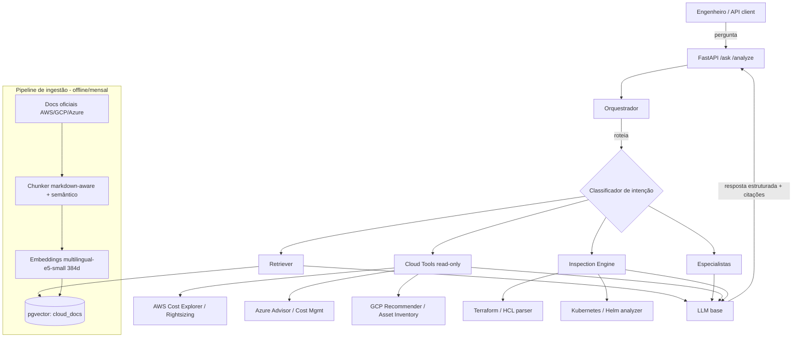

# Arquitetura Técnica — Cloud Intelligence Platform

## 1. Visão geral

A CIP é um sistema **RAG-first com orquestração de especialistas** e **tools read-only**.
O LLM só raciocina; o conhecimento vem do banco vetorial e os fatos voláteis (preço,
inventário) vêm de chamadas ao vivo às APIs das clouds.



## 2. Componentes

### 2.1 Orquestrador (`cip.agents.orchestrator`)
- Classifica a intenção (conhecimento puro, análise de ambiente, custo, inspeção de IaC).
- Decide quais especialistas e tools acionar.
- Consolida as respostas parciais num relatório estruturado com priorização.

### 2.2 Retriever + RAG engine (`cip.rag`)
- Embeddings locais `intfloat/multilingual-e5-small` (384d) — custo zero por token.
- Busca vetorial no `pgvector` com filtro por `cloud`, `service`, `category`, `framework`.
- Aplica `RETRIEVAL_MIN_SCORE` para descartar contexto irrelevante (anti-alucinação).

### 2.3 Especialistas (`cip.agents.specialists`)
Cada especialista é um prompt + conjunto de tools/filtros de retrieval focados:
`aws`, `gcp`, `azure`, `kubernetes`, `terraform`, `finops`, `security`, `sre`.
Introduzidos incrementalmente (ver roadmap).

### 2.4 Cloud Tools read-only (`cip.tools`)
- **AWS**: Cost Explorer, Rightsizing, volumes/snapshots órfãos.
- **Azure**: Advisor (Cost/Security/HA), Cost Management.
- **GCP**: Recommender (custo, idle resources), Asset Inventory.
- Trava global `CIP_READONLY=true`: qualquer tentativa de ação mutante é bloqueada.

### 2.5 Inspection Engine (`cip.inspection`)
- **Terraform/HCL**: parser + regras (recursos públicos, sem criptografia, sem tags, etc.).
- **Kubernetes/Helm**: manifestos (privileged, sem limits, hostNetwork, RBAC amplo).

### 2.6 Persistência
- `cloud_docs`: base de conhecimento (RAG).
- `environments` / `analyses` / `findings`: histórico e priorização.

## 3. Fluxo de uma requisição `/analyze`

1. Cliente envia pergunta + (opcional) artefatos IaC/manifestos + escopo de cloud.
2. Orquestrador classifica e monta o plano de execução.
3. Retriever traz contexto oficial; tools trazem dados ao vivo; inspection analisa arquivos.
4. Especialistas relevantes geram achados (findings) com severidade + impacto financeiro.
5. Orquestrador consolida no formato padrão (resumo executivo → riscos → plano → roadmap).
6. Resultado é persistido (`analyses` + `findings`) e retornado com citações.

## 4. Formato padrão de resposta

```
1. Resumo executivo
2. Arquitetura atual (inferida)
3. Achados por domínio (segurança, custo, confiabilidade, performance, operações)
4. Priorização (Critical/High/Medium/Low + impacto $ + esforço + ROI)
5. Plano de melhorias + roadmap
6. Referências oficiais (com URL/versão)
```

## 5. Anti-alucinação (como garantimos "não genérico")

| Mecanismo | Efeito |
|---|---|
| Retrieval obrigatório + `min_score` | Sem contexto relevante → responde "não encontrei referência confiável" |
| Filtro por `cloud`/`service` | Resposta ancorada no provedor certo |
| Whitelist de serviços no prompt | Impede invenção de serviços inexistentes |
| Preço/inventário só via tool | Zero preço "de memória" |
| Citação obrigatória `[cloud, serviço, título, url]` | Auditabilidade |

## 6. Segurança e multi-tenant

- Credenciais temporárias (STS / Workload Identity / Managed Identity).
- Escopo IAM mínimo read-only (ver `iac/`).
- Isolamento por `tenant_id` em `environments`/`analyses`.
- Criptografia em trânsito e repouso; mascaramento de PII nos logs de prompt.

## 7. Observabilidade

- `structlog` para logs estruturados.
- Langfuse (opcional) para tracing de RAG e custo por chamada.
- Métricas: latência p95, custo/query, taxa de "sem fonte", cache hit das tools.
