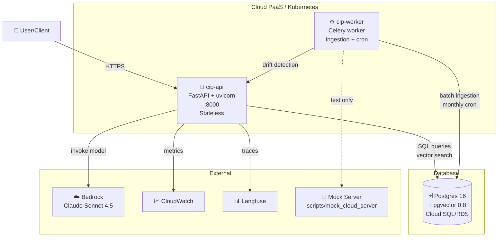
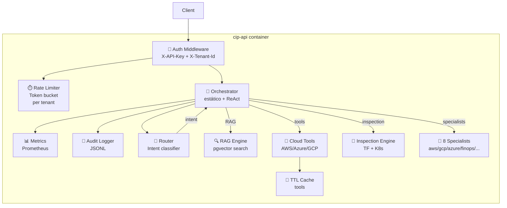
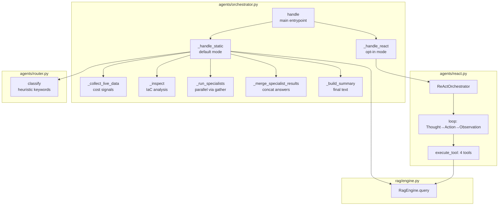
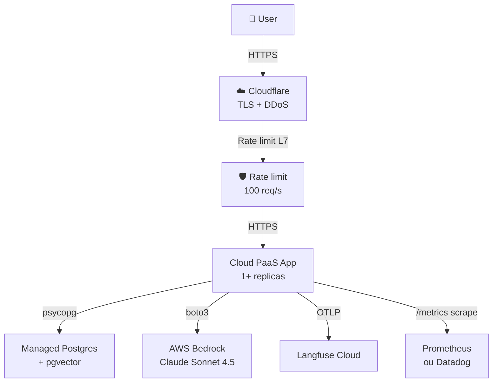
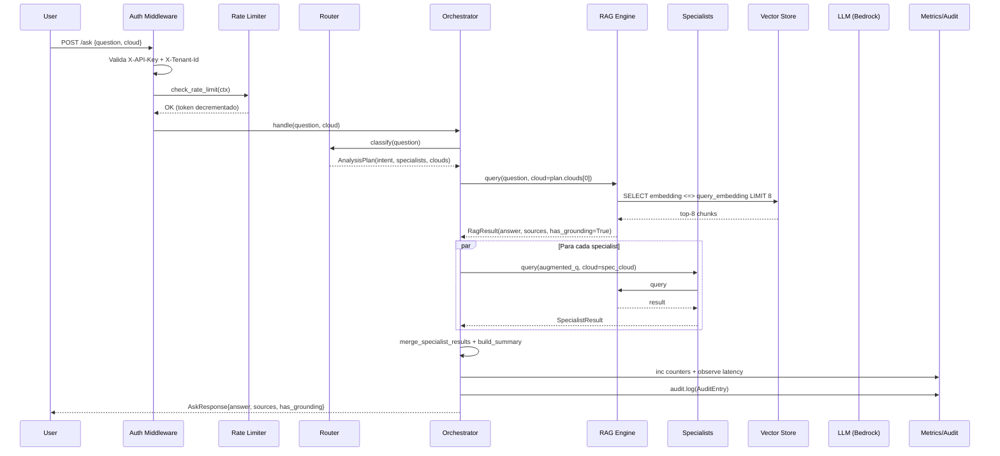
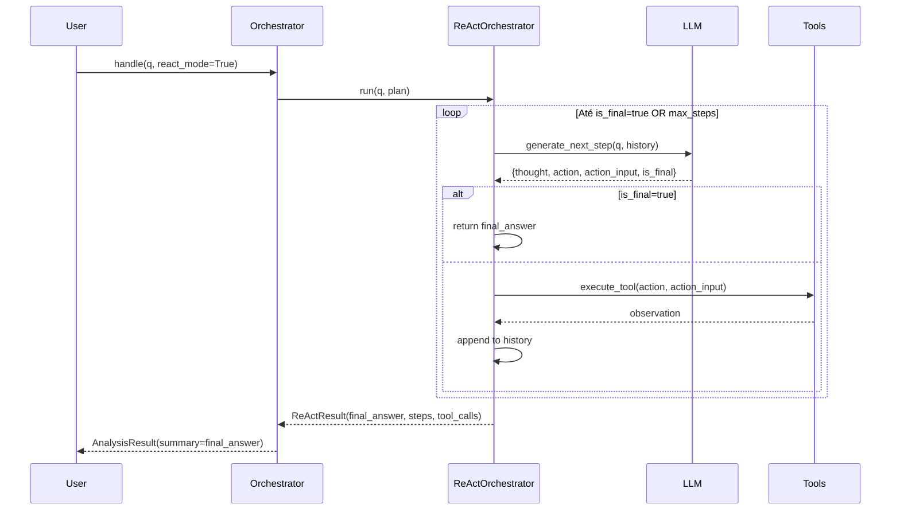

# CIP — C4 Architecture

> **Date**: 2026-08-24 | **Version**: 1.0
> **Model**: C4 (Context, Container, Component, Code) — Simon Brown
> **Audience**: Engineers, Architects, SREs

---

## 1. System Context (C1)

**Context diagram**: shows CIP and how it relates to users and external systems.

```mermaid
graph TB
    User[👤 Cloud Engineer /<br/>SRE / Architect]
    API[🤖 CIP API<br/>LLM especialista<br/>AWS/GCP/Azure]
    Bedrock[☁️ AWS Bedrock<br/>Claude Sonnet 4.5]
    PG[(🗄️ Postgres<br/>+ pgvector)]
    CW[☁️ CloudWatch<br/>Observability]
    LF[📊 Langfuse<br/>Tracing opcional]
    Mock[🧪 Mock Cloud APIs<br/>Dev/CI only]

    User -->|HTTPS /ask<br/>/analyze| API
    API -->|Embeddings +<br/>vector search| PG
    API -->|LLM calls| Bedrock
    API -->|Traces| LF
    API -->|Metrics| CW
    API -.->|Mock mode<br/>(dev/CI)| Mock
```

**Personas and usage:**
- **Cloud Engineer**: asks technical questions, receives answers with citations
- **SRE**: analyzes K8s/Terraform manifests, receives prioritized findings
- **Architect**: compares multi-cloud options, receives trade-off tables

**External systems:**
- **Postgres + pgvector**: vector store for RAG
- **AWS Bedrock**: LLM (Claude Sonnet 4.5)
- **Langfuse** (optional): distributed tracing
- **CloudWatch** / Datadog: metrics/logs
- **Mock Cloud APIs** (dev/CI only): emulates AWS/Azure/GCP for testing

---

## 2. Container Diagram (C2)

**Decomposition into containers** (deployable units):



**Container responsibilities:**

### `cip-api` (FastAPI)
- **Endpoints**: `/health`, `/health/live`, `/health/ready`, `/metrics`, `/ask`, `/analyze`
- **Responsibilities**:
  - Auth (API key + tenant_id)
  - Rate limiting (token bucket per tenant)
  - RAG retrieval (pgvector)
  - LLM orchestration (static OR ReAct)
  - Live tools (Cost/Advisor/Recommender)
  - Inspection Engine (TF + K8s)
  - Audit logging + Prometheus metrics
- **Stateless**: state in Postgres+Redis

### `cip-worker` (Celery beat + worker)
- **Jobs**:
  - `monthly_cron` — drift detection (1st day of each month)
  - `ingest_full` — exhaustive ingestion (manual)
  - `eval_run` — eval suite (manual or CI)
- **Benefit**: long-running tasks without blocking the API

### `Postgres + pgvector`
- **Schemas**:
  - `data_cloud_docs` — knowledge base (chunks + embeddings)
  - `environments` — environments analyzed per tenant
  - `analyses` — analysis history
  - `findings` — prioritized findings
- **Operation**: managed PG (Cloud SQL, RDS) or another

### `Bedrock`
- **Default model**: `anthropic.claude-sonnet-4-5-20250929-v1:0`
- **Fallback**: local stub when `LLM_PROVIDER=stub` (dev/test)

---

## 3. Component Diagram (C3)

**Decomposition of the `cip-api` container** into components:



**Component responsibilities:**

### Auth Middleware (`cip/api/auth.py`)
- Validates `X-API-Key` against `CIP_API_KEYS` (format `key:tenant:rpm`)
- Extracts `X-Tenant-Id` (optional, must match the key)
- Returns a `TenantContext` for the rest of the pipeline
- In dev: accepts without auth (warning log)

### Rate Limiter (`cip/api/auth.py`)
- Token bucket per tenant (lazy init with full tokens)
- Proportional refill: `tokens_added = elapsed * (rpm/60)`
- HTTP 429 with `Retry-After` when exceeded

### Metrics (`cip/observability.py`)
- In-memory registry (counters + histograms)
- Prometheus text format exposed at `/metrics`
- Labels per endpoint/status/tenant
- Reset at each startup (not persistent)

### Audit Logger (`cip/observability.py`)
- Append-only JSONL at `CIP_AUDIT_LOG_PATH`
- Each request → entry with tenant, endpoint, status, latency
- Minimal PII (only 100 chars of question_preview)

### Router (`cip/agents/router.py`)
- Keyword-based heuristics
- 5 intents: KNOWLEDGE, ENVIRONMENT, COST, IAC_REVIEW, COMPARE
- 1-3 specialists per query (cap=3)
- Combines cloud provider + domain

### Orchestrator (`cip/agents/orchestrator.py`)
- **Static mode** (default): classifier → tools → parallel specialists → merge
- **ReAct mode** (opt-in): loop Thought→Action→Observation (max 5 steps)
- Graceful fallback: ReAct failed → static

### RAG Engine (`cip/rag/engine.py`)
- pgvector with HNSW index
- Filters: cloud, service, category
- Score threshold: `RETRIEVAL_MIN_SCORE=0.80` (e5-small)
- Returns `answer + sources + has_grounding`

### Cloud Tools (`cip/tools/{aws_cost,azure_advisor,gcp_recommender}.py`)
- Read-only (ADR-0003): Cost Explorer, Advisor, Recommender
- TTL cache (default 1h) per method
- Mock mode: `CIP_USE_MOCK_CLOUDS=true` → HTTP to mock server

### Inspection Engine (`cip/inspection/{terraform,kubernetes}.py`)
- 7 Terraform rules: encryption, SG, oversized, tags, etc.
- 7 K8s rules: privileged, hostNetwork, RBAC, probes, etc.
- Each finding has: severity, domain, $ impact, references
- Severity: critical/high/medium/low

### 8 Specialists (`cip/prompts/specialists.py`)
- 3 cloud providers: aws, gcp, azure
- 5 domains: finops, security, sre, kubernetes, terraform
- Each one: system prompt + RAG filtered by its context
- Specific tools (FinOps → cost tools)

### TTL Cache (`cip/tools/cache.py`)
- Token bucket per method
- `@cached(ttl=3600)` decorator
- Reset in production every hour (TTL)

---

## 4. Code Diagram (C4) — Orchestrator

**Code diagram of the orchestrator** (internal components):



---

## 5. Deployment Diagram (Cloud PaaS)



**Scaling:**
- **Vertical** (1 replica): scale memory/CPU on the PaaS
- **Horizontal** (N replicas): `gcloud run services update cip --min-instances N` (or similar per PaaS)
- **Embedding offload**: `EMBED_PROVIDER=bedrock` to free 1.5GB RAM per replica

---

## 6. Data Flow Diagram

**Flow of a typical `/ask` request:**



**ReAct flow** (opt-in):



---

## 7. Trade-offs and Architectural Decisions

See `docs/adr/` for detailed ADRs:

- **ADR-0001**: RAG-first (no fine-tuning for knowledge)
- **ADR-0002**: pgvector as vector DB
- **ADR-0003**: Read-only tools for live data
- **ADR-0004**: Claude via Bedrock + local e5-small
- **ADR-0005** (NEW): Static mode + ReAct as opt-in

---

## 8. Extension Points

To add a new cloud provider (e.g. Oracle Cloud):

1. **Create a tool** in `src/cip/tools/oracle_cloud.py` (same AWS/Azure/GCP pattern)
2. **Register it in the orchestrator** (`collect_cost_signals`)
3. **Add keywords** in `agents/router.py` (CLOUD_KEYWORDS)
4. **Add a specialist** in `prompts/specialists.py` (oracle_specialist)
5. **Create a ReAct tool** if you want to expose it via ReAct mode
6. **Add it to the mock server** for testing (`mock_cloud_server.py`)

---

**Last updated**: 2026-08-24
**Version**: 1.0
**Maintainer**: Senior Cloud Engineer
