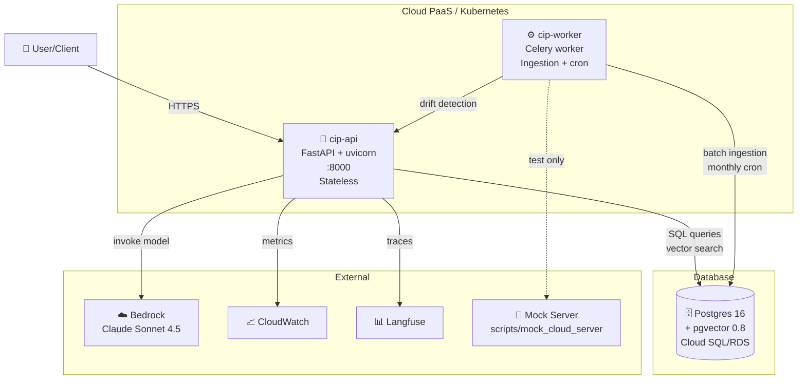
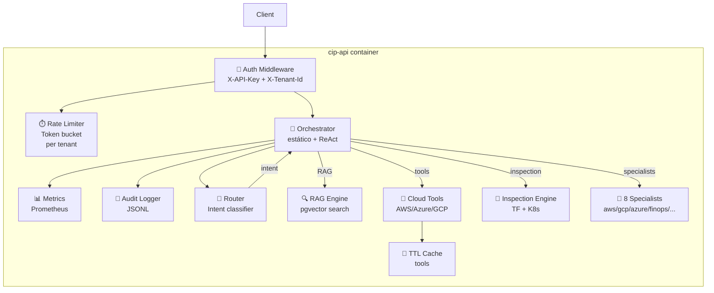
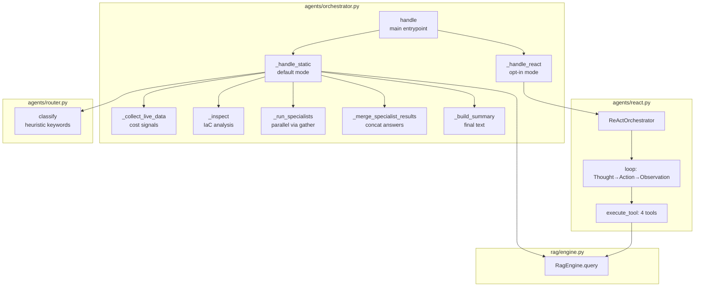
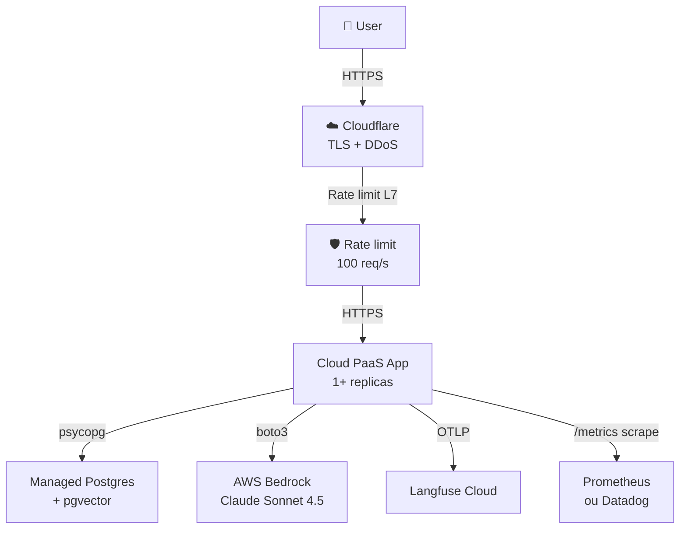
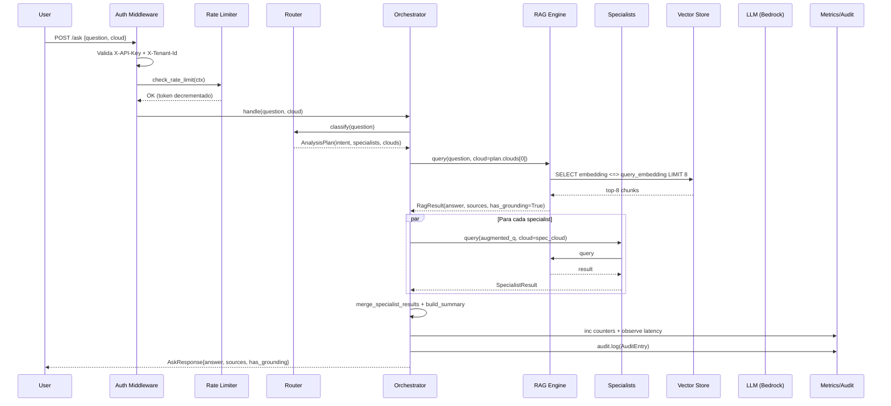
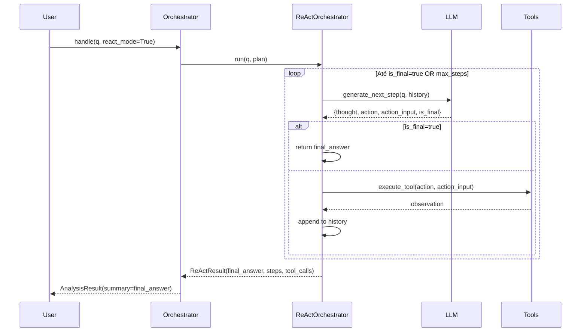

# CIP — C4 Architecture

> **Data**: 2026-08-24 | **Versão**: 1.0
> **Modelo**: C4 (Context, Container, Component, Code) — Simon Brown
> **Audiência**: Engenheiros, Arquitetos, SREs

---

## 1. System Context (C1)

**Diagrama de contexto**: mostra o CIP e como ele se relaciona com usuários e sistemas externos.

```mermaid
graph TB
    User[👤 Cloud Engineer /<br/>SRE / Architect]
    API[🤖 CIP API<br/>LLM especialista<br/>AWS/GCP/Azure]
    Bedrock[☁️ AWS Bedrock<br/>Claude Sonnet 4.5]
    PG[(🗄️ Postgres<br/>+ pgvector)]
    CW[☁️ CloudWatch<br/>Observability]
    LF[📊 Langfuse<br/>Tracing opcional]
    Mock[🧪 Mock Cloud APIs<br/>Dev/CI only]

    User -->|HTTPS /ask<br/>/analyze| API
    API -->|Embeddings +<br/>vector search| PG
    API -->|LLM calls| Bedrock
    API -->|Traces| LF
    API -->|Metrics| CW
    API -.->|Mock mode<br/>(dev/CI)| Mock
```

**Personas e uso:**
- **Cloud Engineer**: faz perguntas técnicas, recebe respostas com citações
- **SRE**: analisa manifests K8s/Terraform, recebe findings priorizados
- **Architect**: compara opções multi-cloud, recebe tabelas de trade-offs

**Sistemas externos:**
- **Postgres + pgvector**: vector store para RAG
- **AWS Bedrock**: LLM (Claude Sonnet 4.5)
- **Langfuse** (opcional): distributed tracing
- **CloudWatch** / Datadog: metrics/logs
- **Mock Cloud APIs** (dev/CI only): emula AWS/Azure/GCP para testes

---

## 2. Container Diagram (C2)

**Decomposição em containers** (deployable units):



**Container responsibilities:**

### `cip-api` (FastAPI)
- **Endpoints**: `/health`, `/health/live`, `/health/ready`, `/metrics`, `/ask`, `/analyze`
- **Responsabilidades**:
  - Auth (API key + tenant_id)
  - Rate limiting (token bucket por tenant)
  - RAG retrieval (pgvector)
  - LLM orchestration (estático OU ReAct)
  - Tools ao vivo (Cost/Advisor/Recommender)
  - Inspection Engine (TF + K8s)
  - Audit logging + metrics Prometheus
- **Stateless**: state em Postgres+Redis

### `cip-worker` (Celery beat + worker)
- **Jobs**:
  - `monthly_cron` — drift detection (1º dia de cada mês)
  - `ingest_full` — ingestion exaustiva (manual)
  - `eval_run` — eval suite (manual ou CI)
- **Benefit**: tasks longas sem bloquear API

### `Postgres + pgvector`
- **Schemas**:
  - `data_cloud_docs` — base de conhecimento (chunks + embeddings)
  - `environments` — ambientes analisados por tenant
  - `analyses` — histórico de análises
  - `findings` — findings priorizados
- **Operação**: managed PG (Cloud SQL, RDS) ou outro

### `Bedrock`
- **Modelo default**: `anthropic.claude-sonnet-4-5-20250929-v1:0`
- **Fallback**: stub local quando `LLM_PROVIDER=stub` (dev/test)

---

## 3. Component Diagram (C3)

**Decomposição do container `cip-api`** em componentes:



**Component responsibilities:**

### Auth Middleware (`cip/api/auth.py`)
- Valida `X-API-Key` contra `CIP_API_KEYS` (formato `key:tenant:rpm`)
- Extrai `X-Tenant-Id` (opcional, deve bater com a chave)
- Retorna `TenantContext` para o resto do pipeline
- Em dev: aceita sem auth (warning log)

### Rate Limiter (`cip/api/auth.py`)
- Token bucket por tenant (lazy init com tokens cheios)
- Refill proporcional: `tokens_added = elapsed * (rpm/60)`
- HTTP 429 com `Retry-After` quando excede

### Metrics (`cip/observability.py`)
- Registry in-memory (counters + histograms)
- Formato Prometheus text exposto em `/metrics`
- Labels por endpoint/status/tenant
- Reset em cada startup (não persistente)

### Audit Logger (`cip/observability.py`)
- Append-only JSONL em `CIP_AUDIT_LOG_PATH`
- Cada request → entry com tenant, endpoint, status, latency
- PII mínima (apenas 100 chars de question_preview)

### Router (`cip/agents/router.py`)
- Heurística por keywords
- 5 intents: KNOWLEDGE, ENVIRONMENT, COST, IAC_REVIEW, COMPARE
- 1-3 specialists por query (cap=3)
- Combina provedor-cloud + domínio

### Orchestrator (`cip/agents/orchestrator.py`)
- **Modo estático** (default): classifier → tools → specialists paralelos → merge
- **Modo ReAct** (opt-in): loop Thought→Action→Observation (max 5 steps)
- Fallback gracioso: ReAct falhou → estático

### RAG Engine (`cip/rag/engine.py`)
- pgvector com HNSW index
- Filtros: cloud, service, category
- Threshold de score: `RETRIEVAL_MIN_SCORE=0.80` (e5-small)
- Retorna `answer + sources + has_grounding`

### Cloud Tools (`cip/tools/{aws_cost,azure_advisor,gcp_recommender}.py`)
- Read-only (ADR-0003): Cost Explorer, Advisor, Recommender
- Cache TTL (default 1h) por método
- Mock mode: `CIP_USE_MOCK_CLOUDS=true` → HTTP para mock server

### Inspection Engine (`cip/inspection/{terraform,kubernetes}.py`)
- 7 regras Terraform: encryption, SG, oversized, tags, etc.
- 7 regras K8s: privileged, hostNetwork, RBAC, probes, etc.
- Cada finding tem: severity, domain, $ impact, references
- Severity: critical/high/medium/low

### 8 Specialists (`cip/prompts/specialists.py`)
- 3 provedor-cloud: aws, gcp, azure
- 5 domínio: finops, security, sre, kubernetes, terraform
- Cada um: system prompt + RAG filtrado pelo seu contexto
- Tools específicas (FinOps → tools de cost)

### TTL Cache (`cip/tools/cache.py`)
- Token bucket por método
- Decorator `@cached(ttl=3600)`
- Reset em produção a cada hora (TTL)

---

## 4. Code Diagram (C4) — Orchestrator

**Diagrama de código do orchestrator** (componentes internos):



---

## 5. Deployment Diagram (Cloud PaaS)



**Scaling:**
- **Vertical** (1 replica): scale memory/CPU no PaaS
- **Horizontal** (N replicas): `gcloud run services update cip --min-instances N` (ou similar por PaaS)
- **Embedding offload**: `EMBED_PROVIDER=bedrock` para liberar 1.5GB RAM por replica

---

## 6. Data Flow Diagram

**Fluxo de uma request `/ask` típica:**



**Fluxo ReAct** (opt-in):



---

## 7. Trade-offs e Decisões Arquiteturais

Ver `docs/adr/` para ADRs detalhados:

- **ADR-0001**: RAG-first (não fine-tuning para conhecimento)
- **ADR-0002**: pgvector como vector DB
- **ADR-0003**: Tools read-only para dados ao vivo
- **ADR-0004**: Claude via Bedrock + e5-small local
- **ADR-0005** (NOVO): Modo estático + ReAct como opt-in

---

## 8. Pontos de Extensão

Para adicionar novo provedor cloud (ex: Oracle Cloud):

1. **Criar tool** em `src/cip/tools/oracle_cloud.py` (mesmo padrão AWS/Azure/GCP)
2. **Registrar no orchestrator** (`collect_cost_signals`)
3. **Adicionar keywords** em `agents/router.py` (CLOUD_KEYWORDS)
4. **Adicionar specialist** em `prompts/specialists.py` (oracle_specialist)
5. **Criar ReAct tool** se quiser expor via ReAct mode
6. **Adicionar no mock server** para testes (`mock_cloud_server.py`)

---

**Última atualização**: 2026-08-24
**Versão**: 1.0
**Mantenedor**: Engenheiro Sênior Cloud
